<!-- GitHub Profile README -->


 

 

## 🌊 About Me

> **모델의 점수보다 오류의 방향을 먼저 봅니다. 불량을 통과시키는 오류, 병든 잎을 정상으로 보는 오류부터 줄입니다.**

<table>
<tr>
<td width="33%" valign="top">

**🧪 Evaluation & Failure Analysis**

데이터 Split → 성능 평가 → **실패 사례를 직접 보고 원인 확인** → 다음 버전까지, ‘**이 숫자를 믿어도 되는가**’부터 확인합니다.

</td>
<td width="33%" valign="top">

**🔍 Vision AI · Model to Service**

OpenCV Rule 검사, **YOLO11** 객체 검출, **ResNet-18** Fine-tuning을 거쳐 **FastAPI · Celery · Docker**로 서빙했습니다.

</td>
<td width="33%" valign="top">

**🌿 Bio × AI**

해조류(김) 박사 · 김 육상양식 **기업부설연구소장** 출신. 생물과 현장을 아는 사람으로서 **데이터를 설계**합니다.

</td>
</tr>
</table>

 

## 📊 Impact at a Glance

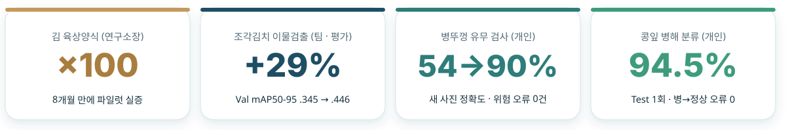

※ 모든 수치는 실제 실행 기록값입니다. 조각김치 이물검출은 6인 팀 공동 성과이며, 저는 Split · 평가 · 실패 분석을 맡았습니다. 연구소 성과는 이력서에 공개한 범위만 적었습니다.

<a href="#top"><b>↑ 맨 위로</b></a>

 

## 🏢 Career — R&amp;D 연구소장

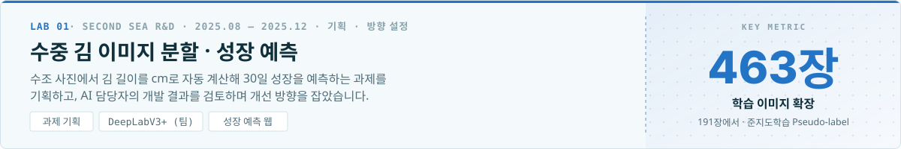

🔒 주식회사 두번째바다 기업부설연구소 연구소장 (2025.06 ~ 2026.06). 사내 프로젝트라 코드 · 데이터는 공개하지 않습니다.

<table>
<tr><td width="96" nowrap><b>양식 R&amp;D</b></td><td>입사 8개월 만에 기초 실험 → <b>100배 규모 파일럿 실증</b> · 환경 변수 통제로 <b>육상양식 표준 방법</b> 정립</td></tr>
<tr><td width="96" nowrap><b>원가 · 품질</b></td><td>자체 배지 개발로 <b>원가 80% 절감 가능성</b> 확인 · 수조 <b>오염 예측 프로그램</b> 구축</td></tr>
<tr><td width="96" nowrap><b>AI 분석</b></td><td>김 <b>성장률 · 색택 이미지</b>를 머신러닝으로 분석해 사진 기반 생산량 예측 연구</td></tr>
<tr><td width="96" nowrap><b>리더십</b></td><td>국책과제 <b>실무책임자</b>로 KPI 총괄 · Bio-AI 팀 <b>데이터 정리 프로세스</b>와 주간 미팅 운영</td></tr>
<tr><td width="96" nowrap><b>학력</b></td><td>공주대학교 생명과학 학 · 석 · 박사 — 방사무늬김의 난균성 병원균 감염과 ROS 신호 연구 · SCI(E) 주저자 1편 · 공저자 5편 · 학회 수상 6건</td></tr>
</table>

<a href="#top"><b>↑ 맨 위로</b></a>

 

## 🚀 Projects

KH정보교육원 [비솔] Vision AI &amp; Vertical AI 융합 전문가 과정 · 2조 Evaluation 담당 · 2026.10 ~

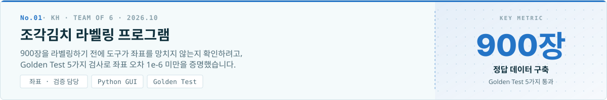

<table>
<tr><td width="96" nowrap><b>기간</b></td><td>2026.10 · 6인 팀 · 내 역할 <b>좌표 · 검증 (Coord)</b></td></tr>
<tr><td width="96" nowrap><b>수행</b></td><td>Class · BBox 기준서, 박스를 항상 <b>원본 픽셀 좌표로 저장</b>해 Zoom · Pan 오차 누적 방지 · 임시 폴더에서 돌리는 <b>Golden Test 5가지</b>(YOLO TXT 왕복 · Zoom/Pan 왕복 &lt; 1e-6 · RAW 보호 등)</td></tr>
<tr><td width="96" nowrap><b>기술</b></td><td><code>Python</code> <code>GUI</code> <code>YOLO TXT I/O</code></td></tr>
</table>

<a href="#top"><b>↑ 맨 위로</b></a>

 

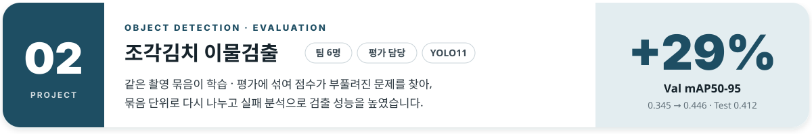

<table>
<tr><td width="96" nowrap><b>기간</b></td><td>2026.10.15 ~ 10.21 · 6인 팀 · 내 역할 <b>Evaluation / Failure</b></td></tr>
<tr><td width="96" nowrap><b>핵심 성과 (팀)</b></td><td>Val mAP50-95 <b>0.345 → 0.446 (+29%)</b> · Frozen Test 75장 <b>0.412</b> (1회 평가) · 위험 이물(플라스틱 · 돌 · 금속) Precision <b>.977</b></td></tr>
<tr><td width="96" nowrap><b>문제</b></td><td>같은 이물 세트(T17_V 조각 등)가 <b>Train과 평가 데이터에 동시에</b> 들어가 성능이 부풀려져 있었습니다.</td></tr>
<tr><td width="96" nowrap><b>내 역할</b></td><td>900장을 <b>촬영 묶음 단위로 다시 Split</b> (609 / 66 / 75 / 150) → 누수 제거로 Baseline Recall .781 → .444 (부풀림 제거) Test는 <code>allow_test</code> 없으면 막히도록 <b>코드로 1회만 허용</b> · Final 모델은 Val만으로 선택</td></tr>
<tr><td width="96" nowrap><b>실패 분석</b></td><td>Baseline 놓침(FN) 82개 중 <b>73%가 작은 이물</b> → 이미지 크기 키우는 실험의 근거 · Test에서는 branch를 insect · leaf로 헷갈린 오검출이 Precision 하락 원인</td></tr>
<tr><td width="96" nowrap><b>기술</b></td><td><code>Python</code> <code>YOLO11</code> <code>Ultralytics</code> <code>mAP · P/R</code> <code>Confusion Matrix</code></td></tr>
</table>

<a href="#top"><b>↑ 맨 위로</b></a>

 

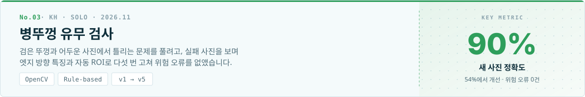

<table>
<tr><td width="96" nowrap><b>기간</b></td><td>2026.11.01 ~ 11.02 · 개인 · 사진 42장 (test 24 · holdout 8 · final 10)</td></tr>
<tr><td width="96" nowrap><b>결과</b></td><td>새 사진 정확도 <b>54% → 90%</b> (v1 test → v3 final) · 불량을 통과시키는 <b>NG→OK 3건 → 0건</b></td></tr>
<tr><td width="96" nowrap><b>문제</b></td><td>수업 방식(v1)은 '어두운 픽셀 양'을 재서, <b>검은 뚜껑과 어두운 사진</b>에서 틀렸습니다.</td></tr>
<tr><td width="96" nowrap><b>수행</b></td><td>버전마다 <b>실패 사진을 직접 보고 원인 확인</b> → 색과 무관한 엣지 방향 특징(세로 줄무늬 vs 가로 나사산) · 병 실루엣 기반 <b>자동 ROI</b> 어둡거나 기울어진 사진은 통과시키지 않고 <b>RETAKE(다시 찍기)</b>로 판정 · 폰 카메라 실시간 모드(v4~v5)</td></tr>
<tr><td width="96" nowrap><b>기술</b></td><td><code>Python</code> <code>OpenCV</code> <code>CLAHE</code> <code>Sobel</code> <code>Otsu</code> <code>Git</code></td></tr>
</table>

<a href="#top"><b>↑ 맨 위로</b></a>

 

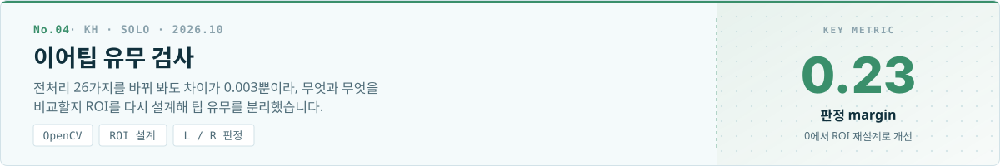

<table>
<tr><td width="96" nowrap><b>기간</b></td><td>2026.10.26 · 개인 · Mini Challenge</td></tr>
<tr><td width="96" nowrap><b>수행</b></td><td>전처리 26가지 비교(param sweep) → 차이 최대 +0.003 · 본체 가장자리를 일부러 포함한 <b>ROI 재설계</b>로 팁 유무 분리 · 가장 단순한 Gaussian 5×5 선택</td></tr>
<tr><td width="96" nowrap><b>기술</b></td><td><code>OpenCV</code> <code>Otsu</code> <code>ROI</code></td></tr>
</table>

<a href="#top"><b>↑ 맨 위로</b></a>

 

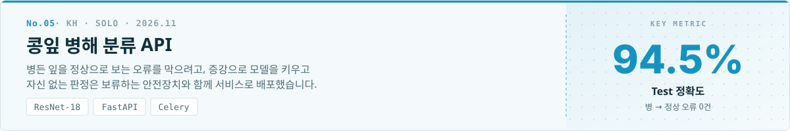

<table>
<tr><td width="96" nowrap><b>기간</b></td><td>2026.11.04 ~ 11.05 · 개인</td></tr>
<tr><td width="96" nowrap><b>결과</b></td><td>Val <b>0.7669 → 1.0</b> (Head-only → Full + 증강) · Test 128장 <b>0.9453</b> (1회) · 병 → 정상 오류 <b>0건</b> 멀리 찍은 사진(0.4배) 정확도 <b>0.384 → 0.895</b></td></tr>
<tr><td width="96" nowrap><b>판단</b></td><td>Test가 2.35%p 낮아도 E6를 서빙 모델로 선택 — 틀린 7장이 모두 점수 &lt; 0.9라 <b>보류(R1)로 걸러지기</b> 때문 · Grad-CAM으로 근거가 잎의 병반에 모이는지 확인 · 콩잎이 아닌 사진은 <b>특징 거리로 경고</b></td></tr>
<tr><td width="96" nowrap><b>서비스</b></td><td>FastAPI → Redis 캐시 → Celery 워커 → PostgreSQL 이력, <b>Docker Compose</b> · 동기 27.8ms / 캐시 HIT 3.1ms · pytest 6 passed</td></tr>
<tr><td width="96" nowrap><b>기술</b></td><td><code>PyTorch</code> <code>Hugging Face</code> <code>ResNet-18</code> <code>Grad-CAM</code> <code>FastAPI</code> <code>Celery</code> <code>Redis</code> <code>PostgreSQL</code> <code>Docker</code></td></tr>
</table>

<a href="#top"><b>↑ 맨 위로</b></a>

 

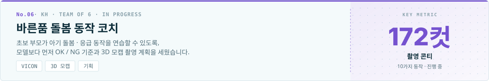

<table>
<tr><td width="96" nowrap><b>기간</b></td><td>2026.11.08 ~ 진행 중 · 6인 팀 · 내 역할 <b>현장 사진 · 기획 문서</b></td></tr>
<tr><td width="96" nowrap><b>수행</b></td><td>10가지 돌봄 · 응급 동작(영아 CPR, 수유 → 트림 등) 촬영 콘티 · Take 규칙 · OK / NG 기준 · 현장 체크리스트</td></tr>
<tr><td width="96" nowrap><b>기술</b></td><td><code>VICON</code> <code>YOLO Pose (예정)</code></td></tr>
</table>

<a href="#top"><b>↑ 맨 위로</b></a>

 

### 🧪 Other Projects

[어디서 진행한 프로젝트인지: 예) 박사과정 연구실 / 개인 / 공모전]

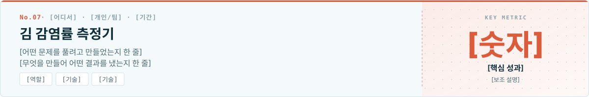

<table>
<tr><td width="96" nowrap><b>기간</b></td><td>[YYYY.MM ~ YYYY.MM] · [개인 / N인 팀] · 내 역할 <b>[역할]</b></td></tr>
<tr><td width="96" nowrap><b>문제</b></td><td>[어떤 문제를 풀려고 만들었는지]</td></tr>
<tr><td width="96" nowrap><b>수행</b></td><td>[무엇을 어떻게 만들었는지]</td></tr>
<tr><td width="96" nowrap><b>결과</b></td><td>[숫자로 보여줄 결과]</td></tr>
<tr><td width="96" nowrap><b>기술</b></td><td><code>[기술]</code></td></tr>
</table>

<a href="#top"><b>↑ 맨 위로</b></a>

 

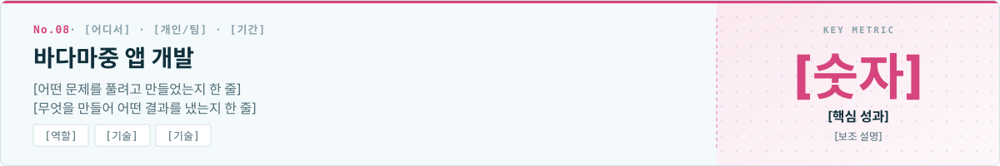

<table>
<tr><td width="96" nowrap><b>기간</b></td><td>[YYYY.MM ~ YYYY.MM] · [개인 / N인 팀] · 내 역할 <b>[역할]</b></td></tr>
<tr><td width="96" nowrap><b>문제</b></td><td>[어떤 문제를 풀려고 만들었는지]</td></tr>
<tr><td width="96" nowrap><b>수행</b></td><td>[무엇을 어떻게 만들었는지]</td></tr>
<tr><td width="96" nowrap><b>결과</b></td><td>[숫자로 보여줄 결과]</td></tr>
<tr><td width="96" nowrap><b>기술</b></td><td><code>[기술]</code></td></tr>
</table>

<a href="#top"><b>↑ 맨 위로</b></a>

 

## 🎯 What I Do

| 영역 | 해 본 것 |
| :--- | :--- |
| **🌿 Bio Research** | 해조류(김) 배양 · 생장 · 병해 연구, 육상양식 100배 규모 실증, 자체 배지 개발 |
| **📏 Data · Evaluation** | 촬영 묶음 단위 Split, Test 1회 평가 규칙, Class별 P/R · 실패 유형(FN · FP · CLASS · BBOX) 분석 |
| **👁️ Machine Vision** | OpenCV Rule 검사 (CLAHE · Sobel · Otsu), 자동 ROI, RETAKE 판정 |
| **🤖 Deep Learning** | 객체 검출 (YOLO11), 이미지 분류 Fine-tuning (ResNet-18), Grad-CAM 근거 확인 |
| **⚙️ Model Serving** | FastAPI · Redis 캐시 · Celery 비동기 작업 · PostgreSQL 기록 · Docker Compose |
| **🧍 3D · Pose** | VICON 모캡 촬영 기획, 동작별 OK / NG 기준 설계 |
| **📝 R&amp;D · Documentation** | 국책과제 제안 · KPI 관리, 라벨 기준서, 실패 분석 보고서, README |

<a href="#top"><b>↑ 맨 위로</b></a>

 

## 🔄 How I Work

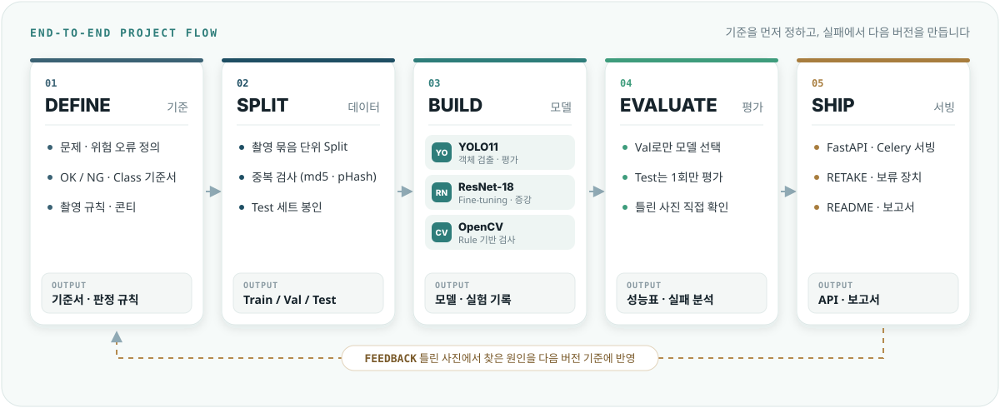

모델을 만들기 전에 <b>무엇을 OK / NG로 볼지</b>와 <b>데이터를 어떻게 나눌지</b>부터 정하고, 평가 후에는 <b>틀린 사진을 직접 보며</b> 찾은 원인을 다음 버전의 기준에 반영합니다.

| 원칙 | 실제로 한 것 |
| :--- | :--- |
| **🧩 같은 촬영 묶음은 쪼개지 않는다** | 누수를 막으려 Split을 묶음 단위로 다시 짬 (02) |
| **🔒 Test는 한 번만 본다** | Val로 고르고 Test는 1회, 코드로 막음 (`allow_test`, 덮어쓰기 금지) |
| **📸 기준을 정한 사진으로 성능을 말하지 않는다** | 매번 새 사진(holdout · final)으로 보고 (03, 04) |
| **⚠️ 위험한 오류부터 줄인다** | 불량을 통과시키는 NG→OK, 병을 정상으로 보는 오류를 먼저 셈 (03, 05) |

<a href="#top"><b>↑ 맨 위로</b></a>

 

## 🛠 Tech Stack

       
 
     

AI · Vision · Serving &nbsp;&nbsp;|&nbsp;&nbsp; Language · Deploy · Collaboration

 

| 분야 | 기술 |
| :--- | :--- |
| 🤖 **AI · Vision** | `PyTorch` `Hugging Face Transformers` `YOLO11 (Ultralytics)` `ResNet-18` `Grad-CAM` |
| 👁️ **Machine Vision** | `OpenCV` `CLAHE` `Sobel` `Otsu` `Morphology` `GrabCut` `HSV` |
| ⚙️ **Backend · Serving** | `FastAPI` `Celery` `Redis` `PostgreSQL` |
| 📏 **Data · Evaluation** | `mAP · P/R` `Confusion Matrix` `pHash · md5` `Excel` |
| 💻 **Language** | `Python` |
| ☁️ **Deploy · Test** | `Docker` `Docker Compose` `pytest` |
| 🧍 **3D · Pose** | `VICON` `YOLO Pose (예정)` |
| 🤝 **Collaboration** | `Git` `GitHub` |

 

## 📚 Now Learning

- 🎓 KH정보교육원 Vision AI &amp; Vertical AI 융합 전문가 과정 (2026.10 ~)
- 📜 **ADsP** (데이터분석 준전문가) · 🐧 **리눅스마스터** 준비 중
- 🎯 다음 목표: 06 촬영 데이터로 동작 분류 · 03 실시간 재시연 · 02 병해 데이터 보강

<a href="#top"><b>↑ 맨 위로</b></a>

 

## 📫 Contact

